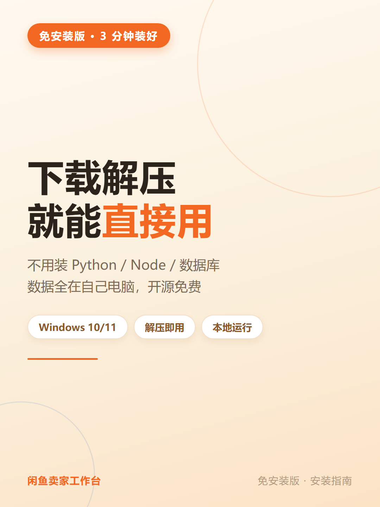
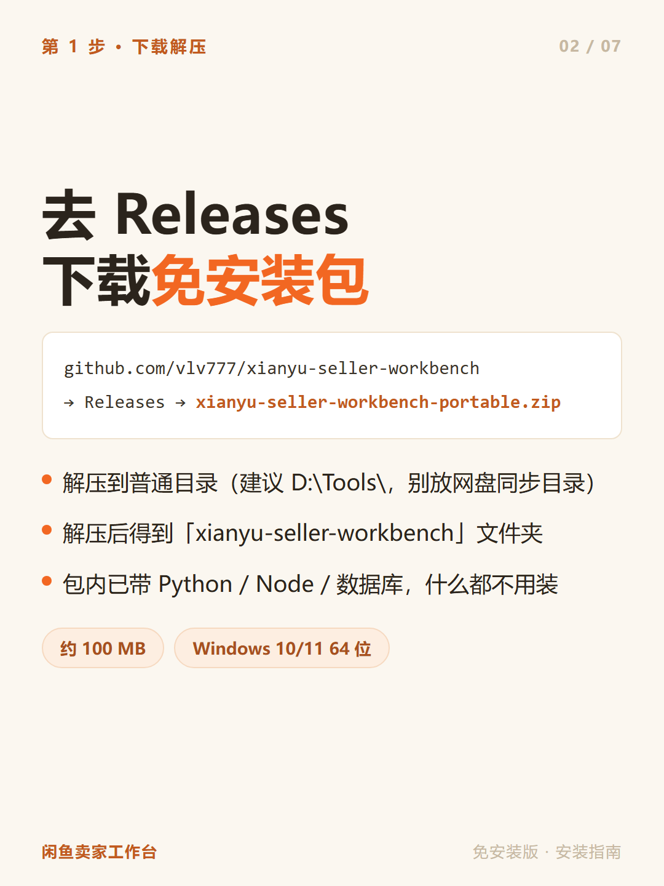
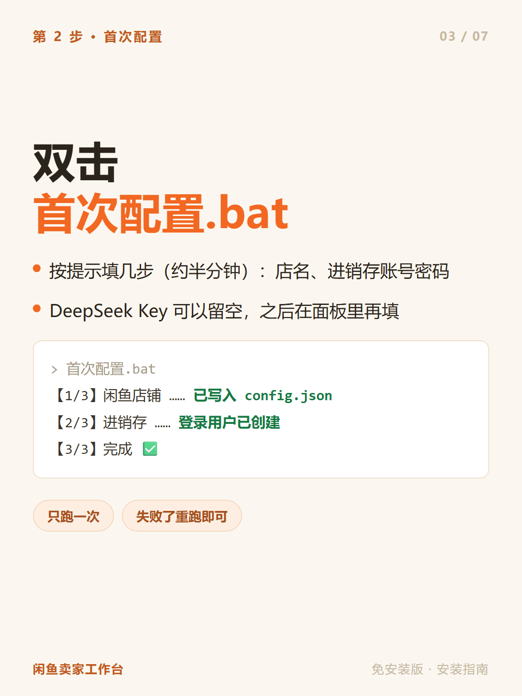
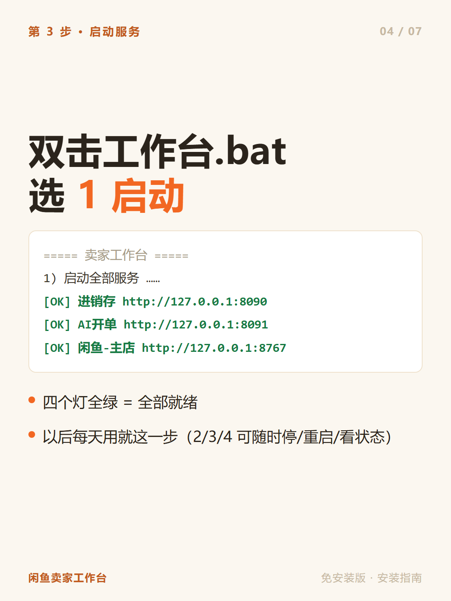
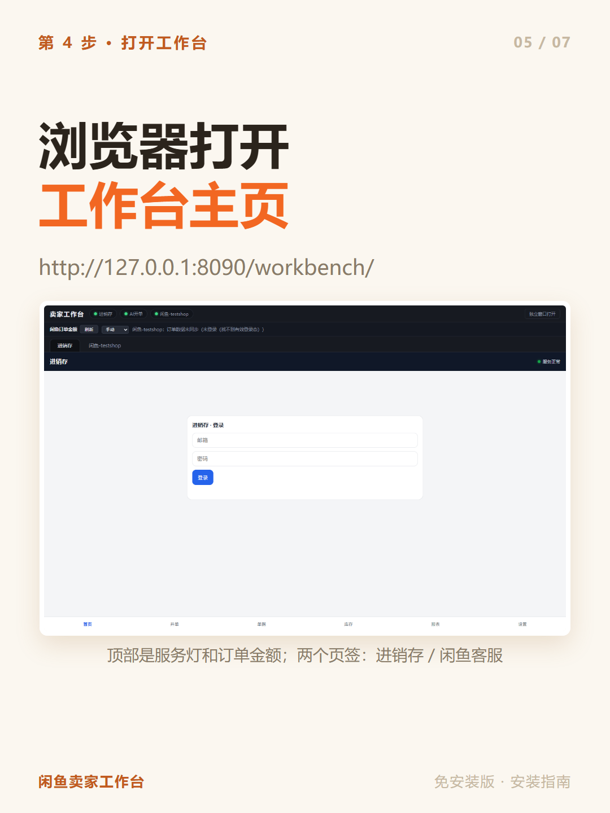
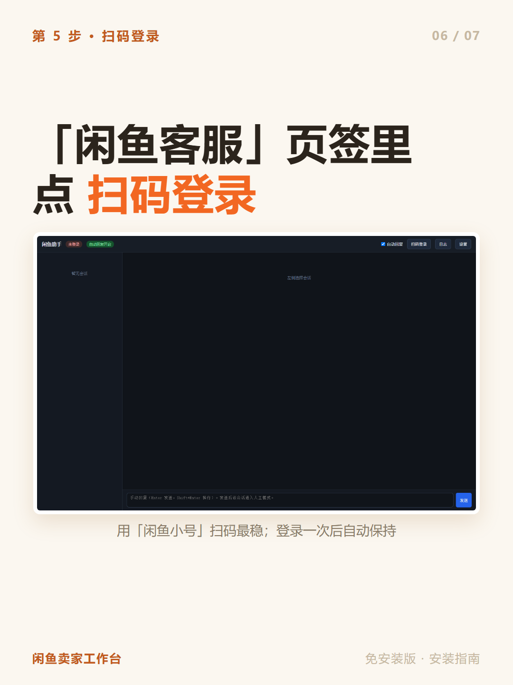

# 安装指南（免安装版 · 图文）

> 适合：Windows 10/11（64 位）。全程**不用装** Python / Node / 数据库。
> 有任何看不懂的，直接把「卡住的步骤 + 报错原文」发给任意 AI 问（见最后一张图）。

---

## 文字版（给喜欢看字的）

1. **下载**：打开 [Releases](https://github.com/vlv777/xianyu-seller-workbench/releases/latest)，
   下载 `xianyu-seller-workbench-portable.zip`（约 100 MB）
2. **解压**：解压到普通目录（建议 `D:\Tools\`，不要放 OneDrive / 网盘同步目录），
   得到 `xianyu-seller-workbench` 文件夹
3. **首次配置**：双击 `setup\首次配置.bat`，按提示填：店铺标识（默认 shop01）、
   进销存邮箱 + 密码（自己定）、DeepSeek Key（可留空）→ 看到「完成 ✅」
4. **启动**：双击 `workbench\工作台.bat` → 输入 `1` → 看到四个 `[OK]` 即全部就绪
5. **打开**：浏览器访问 <http://127.0.0.1:8090/workbench/>；
   在「闲鱼客服」页签里点扫码登录（**建议用闲鱼小号**）

## 日常使用

- 以后每天：双击 `workbench\工作台.bat` → `1` 启动（菜单 `2/3/4` 可停止 / 看状态 / 重启）
- 重启电脑后重新启动一次即可；数据都在这个文件夹里，**整个文件夹拷走即备份**

## 升级（保留数据）

下载新版 zip 解压到新目录，把旧目录里这些**拷过去**：

- `assistant\shops\`、`assistant\软件配置.json`、`assistant\知识库.md`、`assistant\补充知识.md`
- `jxc\pb_data\`、`jxc\ai\ai-config.json`

程序文件用新版（`runtime`、代码都别拷）。

## 常见问题

- **下载慢 / 打不开 GitHub**：用镜像下载
  `https://gh-proxy.com/https://github.com/vlv777/xianyu-seller-workbench/releases/latest/download/xianyu-seller-workbench-portable.zip`
- **.bat 被拦截**：右键文件 → 属性 → 勾选「解除锁定」；杀毒软件里放行本目录
- **端口被占（8090 / 8091 / 8767）**：关掉占用端口的程序；
  或改 `assistant\shops\<店名>\config.json` 里的 `port` 与 `debug_port`
- **其他任何问题**：把「卡住的步骤 + 报错原文」发给 AI 问；
  也可以把仓库里的 [`AI一键部署提示词.md`](AI一键部署提示词.md) 整段粘贴给 AI，让它带你装

—— 项目主页：<https://github.com/vlv777/xianyu-seller-workbench>
